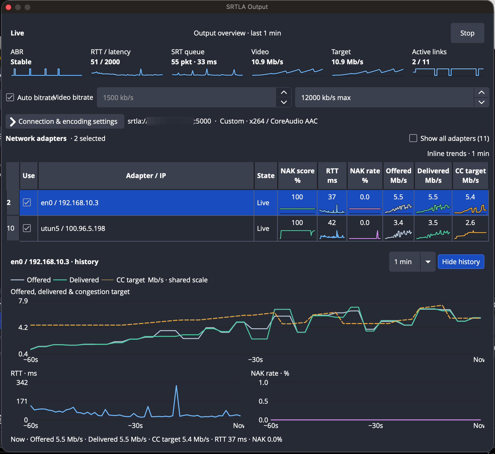

# SRTLA Output for OBS

Native SRTLA output for OBS Studio on Windows x64, macOS, and Linux.

The plugin muxes OBS-encoded audio and video as MPEG-TS, feeds the SRT packets
directly into an embedded SRTLA sender, and distributes the resulting datagrams
over the network links selected in its OBS dock. The SRT session, SRTLA sender,
and uplink sockets all run in the OBS process; no localhost UDP proxy or helper
process is required.

An SRTLA-compatible receiver is required at the destination. This repository
does **not** ship a production receiver. For a local Windows smoke test, see
[`docs/SRTLA-LOCAL-RELAY.md`](docs/SRTLA-LOCAL-RELAY.md).

## Features

- An OBS dock for starting and stopping the output, selecting uplinks, and
  monitoring the session.
- Dedicated video and audio encoders owned by the output, chosen from the
  encoders OBS provides, so OBS streaming and recording are never affected.
- H.264 and HEVC video with AAC or Opus audio.
- Automatic video bitrate control driven by end-to-end SRT RTT, sender-queue
  delay and the measured end-to-end delivery rate, with a pre-roll bandwidth
  probe so streams start at a measured bitrate. Manual bitrate and
  maximum-bitrate controls remain available.
- Per-adapter IPv4 and IPv6 uplinks that can be enabled or disabled while the
  output is running. Newly discovered links are opt-in, and the last enabled
  link cannot be disabled.
- ABR state and thresholds, end-to-end SRT RTT and sender-queue pressure,
  offered and ACK-delivered traffic, current/target video bitrate, raw SRT
  bandwidth and per-link CC telemetry, plus per-link state, NAK-recency score,
  RTT, retransmission-request rate, congestion, and scheduler diagnostics.
- SRT stream ID and optional passphrase authentication. Passphrases are
  confidential configuration and are stored plainly in the OBS profile; they
  are never written to logs or back into the SRTLA URL.
- Automatic SRT reconnection and a bounded, keyframe-aware media queue. After a
  reconnect, stale media is discarded and MPEG-TS resumes with fresh tables at
  the next keyframe.
- Profile-scoped settings and safe teardown when the OBS profile changes.

Automatic bitrate and live manual-bitrate changes require an OBS encoder that
advertises dynamic bitrate support. With a compatible encoder, automatic mode
can be toggled and the manual bitrate adjusted while the output is live. Other
encoders remain usable at a fixed bitrate while the dock continues to show
transport telemetry.

## Dock screenshot



## obs-websocket integration

On OBS Studio 28 and later, this plugin registers the `obs-srtla-output` vendor
with the built-in obs-websocket server. Use the standard `CallVendorRequest`
request with `vendorName: "obs-srtla-output"` and one of these request types:

| Request type | Request data | Purpose |
| --- | --- | --- |
| `GetStatus` | `{}` | Return the current SRTLA and SRT telemetry snapshot. |
| `SetOutputActive` | `{"active":true}` | Start or stop using the connection and encoder settings in the current OBS profile. |
| `SetLinkEnabled` | `{"linkId":"<decimal ID>","enabled":true}` | Enable or disable a configured link. |
| `SetBitrateControl` | `{"automatic":true,"manualBitrateKbps":1500}` | Select automatic or manual video bitrate control. |
| `SetMaxBitrate` | `{"maxBitrateKbps":6000}` | Set the automatic bitrate ceiling. |

While the output is running, `GetStatus` returns the same telemetry fields
shown in the dock, including per-link quality, RTT, retransmission-request rate,
offered and delivered rate, scheduler state, end-to-end SRT RTT and queue depth,
and ABR state. When stopped, it returns the configured links and bitrate
settings. Link `id` values are decimal strings so clients preserve the full
64-bit identifier. The snapshot includes `automatic_bitrate`,
`manual_bitrate_kbps`, and `max_bitrate_kbps` for reading back control settings.
`StatusChanged` vendor events carry that same status object once per second
while the output is running. Subscribe to the obs-websocket `Vendors` event
category to receive them.

Control requests return `success`; failed requests also include an `error`
string. Link changes preserve the dock's last-enabled-link guard. Bitrate values
use kb/s and must fit the ranges shown in the dock. The encoder's dynamic
bitrate capability still applies to live bitrate changes. The vendor API does
not expose the SRT passphrase.

## Current status and limitations

This is an early `0.1.9` development release, not a production-certified
release. The in-process SRT/SRTLA path, OBS output and dock,
adaptive-bitrate controller, platform-native adapter discovery, MPEG-TS muxer,
reconnect path, and bounded engine ABI are implemented.

Current operational limitations:

- The output always creates its own encoders from the selected encoder's
  defaults and the chosen bitrate. Reusing OBS's streaming or recording
  encoders is not supported: automatic bitrate, the startup probe and
  congestion shedding reconfigure the encoder, which must not affect other
  OBS outputs. OBS streaming, recording and the replay buffer can run
  alongside the SRTLA output.
- Network adapters are refreshed by polling once per second; native route-
  change notifications are not implemented yet.
- Receiver interoperability has a local Windows relay smoke-test path, but no
  maintained production-receiver compatibility matrix or hardware/link soak
  coverage yet.
- Packaging produces manual-install archives for Windows, macOS, and Linux.
  Upgrade and release-package QA remain to be completed.

## TODO

- Validate and document interoperability with maintained production SRTLA
  receivers.
- Provision the receiver, SRT tools, privileges, and kernel support needed to
  run the existing network-namespace/netem scenarios in project CI. They are
  currently discovered by the sender workspace test command but skip when
  those dependencies are unavailable.
- Replace or augment one-second adapter polling with Windows route-change
  notifications.
- Run extended hardware-encoder, multi-link, impairment, reconnect, and soak
  testing.
- Complete upgrade and release-package QA.

## Install

The release packages contain an unsigned macOS installation helper rather than
a signed native installer. Close OBS before installing a package.

Packages are built separately for OBS 32 and OBS 33; the package name contains
`obs32` or `obs33`. Pick the one matching your OBS version. OBS 33 changed the
third-party plugin locations on Windows and Linux. It still loads plugins from
the OBS 32 locations, but marks them as "Legacy" in the Plugin Manager, and
OBS 34 will stop loading them.

### Windows

OBS 33: copy the contents of the ZIP's top-level folder into
`C:\ProgramData\obs-studio\plugins`. The result should be
`C:\ProgramData\obs-studio\plugins\srtla-output\srtla-output.dll`, with the
plugin data in `C:\ProgramData\obs-studio\plugins\srtla-output\data`. If an
OBS 32 copy of the plugin is installed under `C:\Program Files\obs-studio`,
remove it.

OBS 32: extract the ZIP into the OBS installation directory, preserving the
`obs-plugins/64bit` and `data/obs-plugins` paths. The default directory is
`C:\Program Files\obs-studio`.

### macOS

The macOS release ZIP includes `install-macos.command`. On Apple Silicon
(M-series CPUs), download the `macos-arm64` package. The helper is not notarized,
so Finder may show an Apple warning with only **Done** and **Move to Trash**.
Use Terminal to run it instead:

1. Open the downloaded ZIP and open the extracted folder.
2. Open **Terminal** (press Command-Space, type `Terminal`, and press Return).
3. Type `zsh ` in Terminal, including the space after `zsh`, but do not press
   Return yet.
4. Drag `install-macos.command` from the extracted folder into the Terminal
   window. macOS will insert the full path automatically.
5. Press Return and wait for the Terminal window to report that installation
   completed. Press Return once more to close it, then start OBS.

The helper uses macOS's standard `zsh` shell; do not replace `zsh` with `bash`.
If macOS still blocks the helper, first try to run it as above, then open
**System Settings > Privacy & Security** and choose **Open Anyway** for
`install-macos.command`. Repeat steps 2–5 afterwards.

The helper copies `srtla-output.plugin` into:

```text
~/Library/Application Support/obs-studio/plugins/
```

It removes the quarantine flag and applies a local ad-hoc signature. If an
older plugin is already installed, it is moved aside as a backup before the
new one is copied.

Manual fallback for technical users:

```sh
plugin="$HOME/Library/Application Support/obs-studio/plugins/srtla-output.plugin"
xattr -dr com.apple.quarantine "$plugin"
codesign --force --deep --sign - "$plugin"
```

### Linux

Extract the `tar.gz` into the same prefix used by OBS. The package follows the
standard OBS layout for its OBS version:

- OBS 33: `lib*/obs-modules/plugins/srtla-output.so` and
  `share/obs/obs-modules/plugins/srtla-output/`;
- OBS 32: `lib*/obs-plugins/srtla-output.so` and
  `share/obs/obs-plugins/srtla-output/`.

Distribution packages may use a different `lib` directory; set
`OBS_SRTLA_OBS_PLUGIN_DIR` when building for that prefix.

Start OBS and open **Docks > SRTLA Output**.

## Use

1. Enter the receiver endpoint as `srtla://host:port`.
2. Enter the stream ID expected by the receiver and, if encryption is required,
   a 10–79-byte UTF-8 passphrase. The passphrase is stored unencrypted in the
   OBS profile on every supported platform.
3. Choose the video and audio encoders (in the connection settings). The
   output creates its own instances of them.
4. Select at least one operational network link.
5. Choose automatic bitrate with a maximum, or disable it and set a manual
   bitrate. With automatic bitrate, **Measure bandwidth before start** (in
   the connection settings, on by default) probes the path for up to about
   three seconds before the encoder starts.
6. Select **Start**. `Live` requires both an established SRT session and at
   least one payload-eligible SRTLA link.

The dock reports `Starting`, `Live`, `Waiting for network`, `Reconnecting`, or
`Error`. `Reconnecting` is recoverable; `Error` indicates a local fatal failure
such as invalid socket, engine, encoder, muxer, or queue state.

## Automatic bitrate control

While the output is active the controller samples the SRT socket every 20 ms
and observes:

- end-to-end smoothed SRT RTT and the negotiated SRT latency;
- sender-queue delay (the time span of unacknowledged data in the SRT send
  buffer);
- the end-to-end delivery rate: unique payload sent minus the growth of data
  in flight, i.e. what the receiver actually acknowledged, over the last half
  second, compared with what was offered one RTT earlier.

It does not use the SRT packet-pair bandwidth estimate or the sum of per-link
SRTLA CC targets to select the encoder bitrate; those remain diagnostics. SRTLA
CC schedules packets across links; end-to-end RTT, queue and delivery decide
whether the offered encoder rate is sustainable.

Baselines are windowed minimums over the last 10 s (RTT floor and queue floor)
plus a noise estimate that is frozen while the path is congested, so a
standing queue is never mistaken for the new normal. Congestion is classified
against those baselines:

- **Light**: RTT or queue noticeably above its floor and either rising,
  delivery falling behind what was offered, or elevated for more than 1.5 s. The target
  drops by 5 % (at least 100 kb/s), or to 95 % of the measured delivery rate.
- **Heavy**: RTT well above the floor or above a fifth of the latency, a
  sender queue above a tenth of the latency budget, or delivery under 75 % of
  what was offered. The target drops to 90 % of the measured delivery rate,
  less what is needed to drain the standing queue within 1.5 s, and by at
  least 10 %.
- **Severe**: RTT at a third of the latency, or a queue at half of it. The
  target drops to 80 % of the delivery rate less the drain allowance (at most
  to 35 % of it). The configured minimum is only used when every link or the
  SRT session is down.

After any cut the controller **settles** for the encoder's reaction time plus
one RTT (0.3 to 1.5 s) before cutting again. Within that window a further cut
is made only when the measured delivery rate shows the previous cut was not
enough by a wide margin. Increases are held until the hold expires and RTT and
queue are back near their floors.

The delivery rate measured while congested becomes the **ceiling**: the
controller's memory of where the path saturates. Increases depend on it:

- Far below the ceiling (or with none known) the target rises by 10 % every
  250 ms, closing at least a quarter of the gap per step when a ceiling is
  known, so a deep cut recovers in about a second.
- Between 85 % and 97 % of the ceiling it approaches by 1.5 % every 500 ms.
- At the ceiling it **dwells**, then probes above it by 2 %, 4 % and 8 % at
  one-second intervals. If all three succeed the ceiling is dropped and the
  fast ramp resumes. Each time congestion confirms the same ceiling the dwell
  doubles (3 s up to 24 s), so a steady path settles instead of sawing.
- When capacity collapses (the ceiling falls below 70 % of its value before
  the congestion episode), the previous ceiling is remembered for a minute.
  Once the path has been healthy for 1.5 s it is retried with the fast ramp,
  once; a retry that fails within 10 s is not repeated.

### Moving and satellite links

Cellular uplinks on a moving vehicle and LEO satellite terminals change
capacity and base RTT continuously. The controller treats three situations
specially so that transient events are not learned as the new capacity:

- **Stalls.** When the acknowledged rate over the last 120 ms falls below a
  third of what was offered (a handover, a momentary outage), cuts still
  protect the queue but are not used to set the ceiling. If RTT and queue are
  back near their floors within 2 s, the bitrate returns to 90 % of its
  pre-stall value and the previous ceiling is restored at once.
- **Base-RTT shifts.** RTT or queue that is elevated but no longer growing
  (with delivery keeping up) is ambiguous: a standing queue or a new base RTT
  after a handover. After 1.5 s the controller makes one drain-sized cut and
  watches for a second. If the RTT excess does not shrink by at least a
  quarter, it adopts the current RTT as the new floor and undoes the cuts made
  in the last 6 s. Light and heavy congestion therefore require growth
  evidence (rising RTT or queue, or delivery falling behind); the severe
  limits, based on the latency budget, apply regardless.
- **Stale ceilings.** The highest delivery rate in the last 30 s (including
  the fast drain after a stall, which proves capacity) is kept as a capacity
  memory. When the controller sits at a ceiling more than 30 % below it and
  the path is healthy, after 1.5 s it doubles the ceiling (capped at the
  memory) and ramps. A retry that hits congestion well below its target within
  5 s doubles the wait before the next one, up to 12 s.

Values applied to OBS are rounded down to 100 kb/s while sub-step changes
accumulate internally, and the target is always clamped to the configured
minimum and maximum. Missing or repeated statistics hold the current target
rather than replaying a congestion event. RTT and queue baselines are reset
after a session transition; the ceiling is kept across reconnects and cleared
when the output starts.

### Audio over video under congestion

When the bitrate controller cannot keep the SRT send queue inside the latency
budget (a sudden fade, or capacity below the configured minimum), the output
stops feeding video into the muxer while audio continues. The picture
freezes and recovers at a keyframe; sound is not interrupted. Audio is only a
few percent of the stream, so protecting it costs almost nothing. This works
in both automatic and manual bitrate mode.

Queue pressure is the SRT sender-queue delay beyond the RTT floor, as a
fraction of the latency left after the floor:

- above 35 % (back below 25 %), frames that nothing references
  (`OBS_NAL_PRIORITY_DISPOSABLE`, typically non-reference B-frames) are
  dropped, once the encoder has shown that it sets OBS frame priorities;
- above 55 % (back below 35 %), all video is dropped. Because delta frames
  depend on earlier frames, video then resumes only at a keyframe;
- a keyframe is sent only if, at the measured delivery rate, it keeps the
  pressure under 80 %. A large keyframe on a thin link would arrive late and
  only delay audio, so the picture stays frozen; small keyframes on a
  congested link pass, giving a keyframe slideshow.

After a reconnect or an overflow of the plugin's own bounded queue, video
likewise resumes at the next keyframe with fresh MPEG-TS tables while audio
keeps flowing; an overflowing queue drops its oldest datagrams, which would
arrive late anyway. Shed frames are counted in OBS's dropped-frames statistic,
and the dock shows **Audio only** in the ABR tile while video is paused, with
counters and the current queue pressure in its tooltip. Keep the keyframe
interval at 1–2 s so video recovers quickly.

While video is paused the stream carries no video packets. FFmpeg places the
MPEG-TS PCR on the video PID, so receivers that strictly require a regular PCR
should be checked with this behaviour.

### Startup bandwidth probe

With automatic bitrate and **Measure bandwidth before start** enabled, the
output connects the SRT session first and, before the encoder starts, sends
MPEG-TS null packets (PID `0x1FFF`, which every demuxer discards) at a rising
rate:

1. 300 ms (at least two RTTs) at 1 Mb/s to learn the idle RTT and queue
   floors;
2. the rate then doubles about every 350 ms until RTT rises, more than 3 % of
   packets are lost, the acknowledged rate falls behind the offered rate, or
   110 % of the configured maximum is sustained;
3. the probe pauses (up to 0.8 s) so the queue it built drains.

The encoder starts at 80 % of the measured delivery capacity (or at the
maximum if that fit without congestion), and the controller starts with that
capacity as its ceiling. The probe is bounded to 2.5 s plus the drain pause.
It runs while OBS is starting the output, so starting takes correspondingly
longer. If the session drops or no SRT feedback arrives, the output starts at
the configured maximum as before. The dock's ABR tooltip shows the probe
result, the learned ceiling and the current thresholds.

Automatic mode without the probe starts at the configured maximum. The default
automatic maximum is 6000 kb/s and its range is capped at 30000 kb/s. This
ceiling does not limit the separate manual-bitrate setting.

The controller and probe are exercised in closed loop against a simulated
bottleneck (encoder lag, SRT RTT smoothing, a drop-tail FIFO, retransmission)
by the engine's unit tests, including time-varying paths: a single cellular
modem on a moving vehicle (capacity random walk, cell-edge fades, handovers
that change base RTT), a three-modem bond, a drive past a tower and a LEO
satellite with 15 s handovers. `cargo test simulation_report -- --nocapture`
and `cargo test mobility_report -- --nocapture` print the metrics.

On a single fading modem the bitrate can only be as low as the configured
minimum plus audio; when capacity falls below that, the queue grows and the
receiver drops late packets. Bonding several modems avoids most of this.

The per-link **NAK score** and **NAK rate** remain SRTLA steering signals, not
end-to-end unrecovered packet loss. A NAK is a retransmission request, and the
rate includes packets that SRT later repairs within its latency window. It is
therefore expected that `srt-live-transmit` can report no final loss while the
dock shows a non-zero NAK rate and a temporarily reduced NAK score.

Turning automatic mode off stops bitrate probing and applies the manual value.
Live automatic/manual switching and live manual changes require an encoder that
advertises OBS dynamic-bitrate support. The automatic maximum can also be
changed while live; lowering it caps a compatible encoder immediately, while
raising it lets the feedback loop probe upward normally.

## Architecture

- `plugin/` — OBS output, dock, platform network monitors, SRT session, and
  libavformat MPEG-TS sink.
- `engine/` — Rust FFI facade, bounded queues, statistics, and adaptive-bitrate
  controller.
- `third_party/irlserver-srt/` — pinned SRT fork with the external-transport
  patch.
- `third_party/srtla_send/` — pinned SRTLA sender implementation and core.

MPEG-TS container syntax is delegated to libavformat. The plugin owns the
custom in-memory AVIO sink and 1316-byte transport packetization. The local
libsrt patch adds `srt_set_external_transport()`, whose versioned callback
contract connects libsrt directly to the bounded engine queues.

## Build

### Requirements

- Windows x64 with an x64 MSVC developer environment;
- macOS 12 or newer with Xcode command-line tools;
- Linux x86_64 or arm64 with a C++17 compiler, Ninja, and pkg-config;
- CMake 3.28 or newer, Git, and stable Rust 1.88 or newer.

The vendored sender has a rustfmt configuration that uses unstable formatting
options. Nightly Rust is needed only to format that vendored workspace, not to
build the plugin or run the project CI configuration.

The pinned provisioning script downloads the OBS 32.2.1 runtime and source,
the matching 2026-07-15 Qt/FFmpeg/mbedTLS dependency bundles, verifies their
archive hashes, and creates the required OBS import libraries. Run it from an
x64 Visual Studio Developer PowerShell:

```powershell
.\scripts\prepare-obs-ci.ps1

Get-Content .ci-deps\paths.env | ForEach-Object {
  $name, $value = $_ -split '=', 2
  Set-Item -Path "Env:$name" -Value $value
}

cmake -S . -B build-obs -G Ninja `
  -DCMAKE_BUILD_TYPE=Release `
  -DOBS_SRTLA_BUILD_TESTS=ON `
  -DOBS_SRTLA_BUILD_VENDOR_SRT=ON `
  -DOBS_SRTLA_REQUIRE_PLUGIN=ON `
  -DCMAKE_PREFIX_PATH="$env:CMAKE_PREFIX_PATH" `
  -DOBS_SRTLA_OBS_SOURCE_DIR="$env:OBS_SRTLA_OBS_SOURCE_DIR" `
  -DOBS_SRTLA_OBS_IMPORT_LIB_DIR="$env:OBS_SRTLA_OBS_IMPORT_LIB_DIR" `
  -DOBS_SRTLA_OBS_RUNTIME_DIR="$env:OBS_SRTLA_OBS_RUNTIME_DIR" `
  -DOBS_SRTLA_FFMPEG_ROOT="$env:OBS_SRTLA_FFMPEG_ROOT" `
  -DOBS_SRTLA_MBEDTLS_ROOT="$env:OBS_SRTLA_MBEDTLS_ROOT"

cmake --build build-obs --config Release --target srtla-output --parallel
ctest --test-dir build-obs -C Release --output-on-failure
cpack --config build-obs\CPackConfig.cmake -C Release
```

The SRT fork and mbedTLS are linked statically into the plugin, so no OpenSSL or
mbedTLS runtime library is shipped. Qt, FFmpeg, and OBS are provided by the
host installation; no static copy of libobs is embedded.

If you already have a compatible OBS SDK and dependency set, provide
`OBS_SRTLA_OBS_SOURCE_DIR`, `OBS_SRTLA_OBS_IMPORT_LIB_DIR`,
`OBS_SRTLA_OBS_RUNTIME_DIR`, `OBS_SRTLA_FFMPEG_ROOT`,
`OBS_SRTLA_MBEDTLS_ROOT`, and the Qt prefix directly instead of running the
provisioning script.

### Targeting OBS 33

The build targets OBS 32 by default. Pass `-DOBS_SRTLA_OBS_VERSION_MAJOR=33`
to build against an OBS 33 SDK. This selects the OBS 33 plugin install layout
and the `obs33` package name, and on macOS raises the default deployment
target to 13.0. Configuration fails if the OBS SDK is newer than the targeted
OBS version, because older OBS releases refuse to load such modules. OBS 33
also requires FFmpeg 8, Qt 6.10 or newer, mbedTLS 3, and on Windows Visual
Studio 2026 with Windows SDK 10.0.26100. `scripts/prepare-obs-ci.ps1` still
provisions OBS 32.2.1.

For macOS and Linux, provide an OBS 32 or OBS 33 development prefix containing the
`libobs` and `obs-frontend-api` CMake packages, Qt6 Widgets, FFmpeg headers and
libraries, and mbedTLS. The same cache variables used by the Windows build can
be supplied directly:

```sh
cmake -S . -B build \
  -G Ninja \
  -DCMAKE_BUILD_TYPE=Release \
  -DOBS_SRTLA_BUILD_TESTS=ON \
  -DOBS_SRTLA_BUILD_VENDOR_SRT=ON \
  -DOBS_SRTLA_REQUIRE_PLUGIN=ON \
  -DCMAKE_PREFIX_PATH="$OBS_SRTLA_OBS_PREFIX" \
  -DOBS_SRTLA_FFMPEG_ROOT="$OBS_SRTLA_FFMPEG_ROOT" \
  -DOBS_SRTLA_MBEDTLS_ROOT="$OBS_SRTLA_MBEDTLS_ROOT"

cmake --build build --parallel
ctest --test-dir build --output-on-failure
cpack --config build/CPackConfig.cmake
```

On macOS, configure one architecture at a time:

```sh
cmake -S . -B build-macos-arm64 -G Xcode \
  -DCMAKE_OSX_ARCHITECTURES=arm64 \
  -DCMAKE_OSX_DEPLOYMENT_TARGET=12.0 \
  -DOBS_SRTLA_REQUIRE_PLUGIN=ON
cmake --build build-macos-arm64 --config Release --parallel
ctest --test-dir build-macos-arm64 -C Release --output-on-failure
cpack --config build-macos-arm64/CPackConfig.cmake -C Release
```

On Linux, use `aarch64`/`arm64` or `x86_64` natively and set
`CMAKE_INSTALL_LIBDIR` when the OBS installation uses a multiarch library
directory, for example `lib/x86_64-linux-gnu`.

The CI matrix builds the plugin natively for Windows x64, Linux x86_64/arm64,
and macOS x86_64/arm64, runs the Rust and CTest suites, validates archive
contents, and uploads one package per architecture. A semantic-version tag
matching the CMake project version publishes all packages and
`SHA256SUMS.txt` as a GitHub Release.

Pushing a plain semantic-version tag that matches the CMake project version
(for example, `0.1.2`) runs the same checks. Only after both jobs pass, GitHub
Actions publishes the five platform/architecture archives and
`SHA256SUMS.txt` as a GitHub Release. Re-running the tagged workflow safely
replaces the release assets. See [TODO](#todo) for the network-namespace/netem
coverage gap.

## License

The plugin code is GPL-2.0-or-later. Vendored dependencies retain their
upstream licenses; see the individual `LICENSE` files under `third_party/`.
